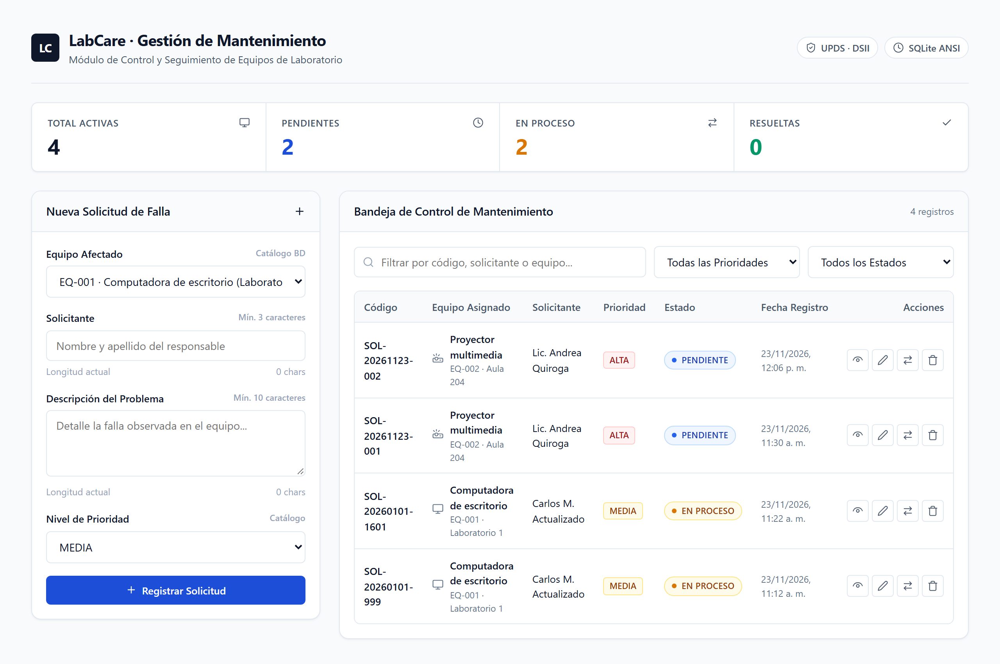
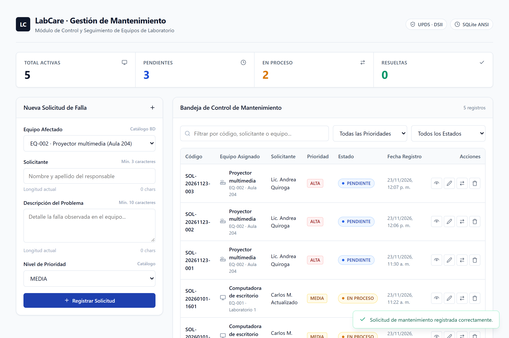
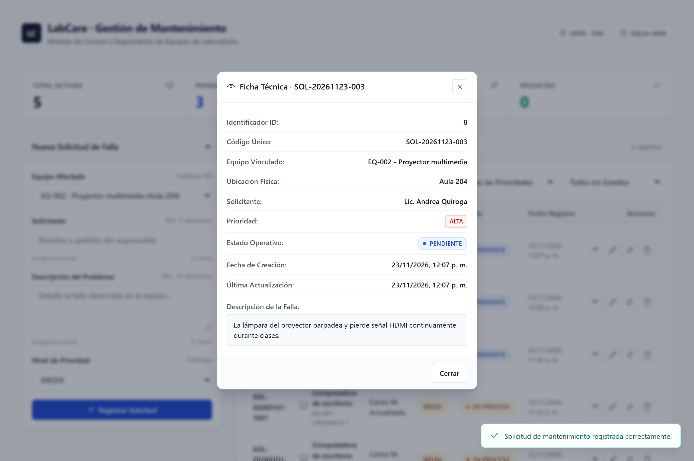
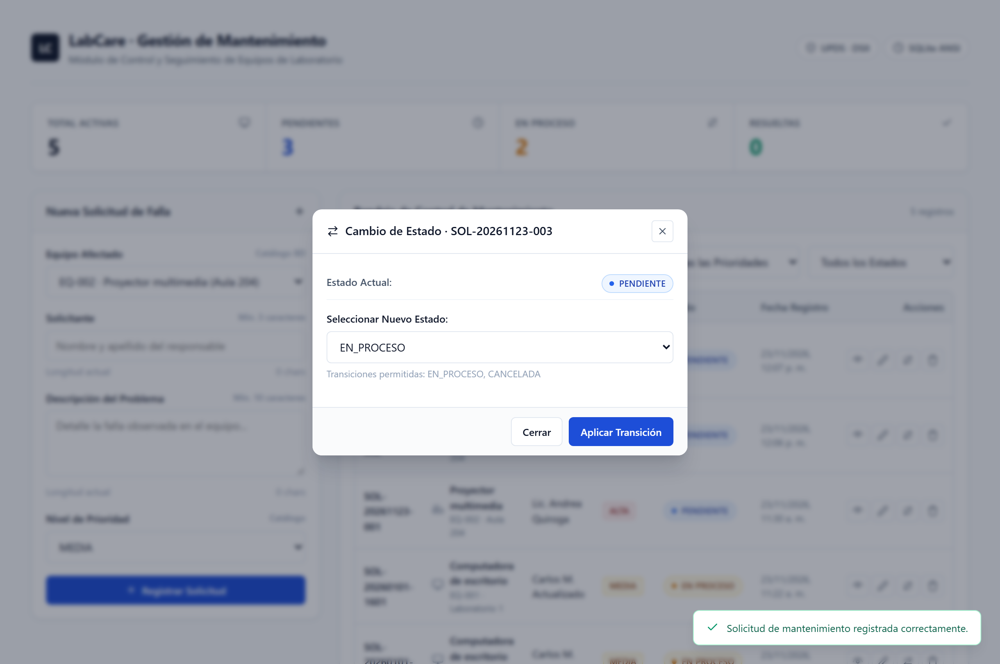
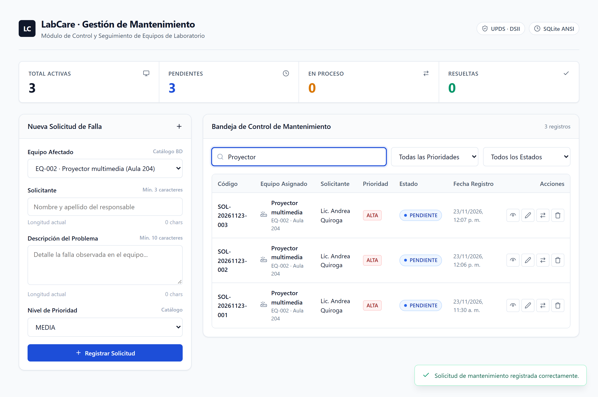
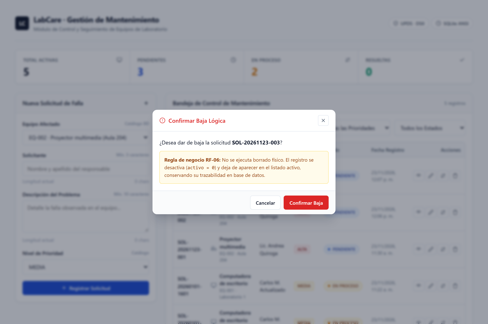

# LabCare · Gestión de Mantenimiento de Equipos de Laboratorio

Sistema web para el control, seguimiento y baja lógica de solicitudes de mantenimiento sobre equipos de cómputo en laboratorios institucionales. Desarrollado como solución práctica integradora para la asignatura **Desarrollo de Sistemas II** en la **Universidad Privada Domingo Savio (UPDS)**.

**Repositorio Oficial:** [https://github.com/Marce0c0/LabCare](https://github.com/Marce0c0/LabCare)  

---

## 1. Arquitectura y Tecnologías

El sistema sigue una arquitectura **MVC (Modelo-Vista-Controlador)** conectada a través de una API REST:

- **Frontend:** React 18, TypeScript, Vite. Interfaz reactiva con modales de control, validación visual y gestión de estados.
- **Backend:** Node.js, Express. Controladores con validación estricta en servidor, enrutamiento semántico y manejo de errores con códigos de estado HTTP estándar (200, 201, 400, 404, 409).
- **Base de Datos:** SQLite estándar utilizando el motor nativo `node:sqlite` de Node.js. Persistencia en disco (`database/labcare.db`) con restricciones relacionales (`FOREIGN KEY`, `UNIQUE`, `CHECK`).

```
                    ┌───────────────────────────┐
                    │  Frontend (React + Vite)  │
                    │   localhost:5173 (SPA)    │
                    └─────────────┬─────────────┘
                                  │ HTTP / JSON
                                  ▼
                    ┌───────────────────────────┐
                    │ Backend MVC (Express API) │
                    │   localhost:3001 (Node)   │
                    └─────────────┬─────────────┘
                                  │ SQL Preparado
                                  ▼
                    ┌───────────────────────────┐
                    │ Base de Datos Relacional  │
                    │     labcare.db (SQLite)   │
                    └───────────────────────────┘
```

---

## 2. Puesta en Marcha Rápida (3 Pasos)

### Requisitos
- Node.js versión 20 o superior (`node -v`).
- Puerto 3001 (Backend) y 5173 (Frontend) disponibles.

### Paso 1: Instalar dependencias
Desde la raíz del proyecto:
```bash
npm install
cd backend && npm install && cd ..
```

### Paso 2: Ejecutar las pruebas automatizadas (Opcional pero recomendado)
Verifica que las 12 reglas de negocio del examen pasen correctamente:
```bash
npm run test
```
*Salida esperada: `12/12 CASOS APROBADOS (0 fallidos)`.*

### Paso 3: Levantar los servicios
Abre dos terminales en la carpeta del proyecto:

**Terminal 1 (Backend MVC en puerto 3001):**
```bash
npm run backend
```

**Terminal 2 (Frontend en puerto 5173):**
```bash
npm run dev
```

Abre en tu navegador:  
👉 **`http://localhost:5173`**

---

## 3. Demostración Visual del Sistema

### Pantalla Principal y Métricas Rápidas
Vista general del módulo con métricas de estado (Activas, Pendientes, En Proceso y Resueltas), formulario de reporte y bandeja de solicitudes.



---

### Registro de Solicitud con Validación en Servidor
Asignación de equipo del catálogo, solicitante, descripción (mínimo 10 caracteres) y prioridad con notificación de confirmación.



---

### Ficha Técnica de Detalle
Consulta completa de la solicitud con datos del equipo asignado y marcas de tiempo de auditoría.



---

### Máquina de Estados de Negocio
Control de transiciones permitidas según el flujo del caso. Las opciones no autorizadas o estados finales se bloquean automáticamente.



---

### Búsqueda y Filtros Combinados
Filtro en tiempo real por término de texto, nivel de prioridad y estado de la solicitud.



---

### Confirmación de Baja Lógica (*Soft Delete*)
Diálogo de confirmación antes de desactivar el registro (`activo = 0`). La solicitud se oculta de la vista operativa sin borrarse de la base de datos.



---

## 4. Reglas de Negocio Implementadas

1. **Catálogo de Equipos:** La solicitud debe asociarse obligatoriamente a un equipo existente en la base de datos (`EQ-001` a `EQ-004`).
2. **Longitud de Campos:**
   - Solicitante: mínimo 3 caracteres sin contar espacios externos.
   - Descripción: mínimo 10 caracteres explicativos.
3. **Prioridad Restringida:** Únicamente valores `BAJA`, `MEDIA` o `ALTA`.
4. **Nomenclatura de Código:** Formato automático `SOL-AAAAMMDD-XXX` con correlativo diario secuencial.
5. **Máquina de Estados:**
   - `PENDIENTE` solo puede transicionar a `EN_PROCESO` o `CANCELADA`.
   - `EN_PROCESO` solo puede transicionar a `RESUELTA` o `CANCELADA`.
   - `RESUELTA` y `CANCELADA` son estados terminales no reversibles (el servidor rechaza cambios con código `409 Conflict`).
6. **Baja Lógica:** La acción `DELETE /solicitudes/:id` actualiza el campo `activo = 0` en lugar de eliminar el registro físico.

---

## 5. Endpoints de la API

| Método | Ruta | Función | Respuesta |
|---|---|---|---|
| `GET` | `/equipos` | Consulta catálogo de equipos de laboratorio | `200 OK` |
| `GET` | `/solicitudes` | Lista solicitudes activas (`?search=`, `?prioridad=`, `?estado=`) | `200 OK` |
| `GET` | `/solicitudes/:id` | Obtiene el detalle completo por identificador | `200 OK`, `404 Not Found` |
| `POST` | `/solicitudes` | Registra solicitud nueva validando campos en servidor | `201 Created`, `400 Bad Request` |
| `PUT` | `/solicitudes/:id` | Edita datos descriptivos (solicitante, descripción, prioridad) | `200 OK`, `400 Bad Request` |
| `PATCH` | `/solicitudes/:id/estado` | Cambia estado validando la máquina de estados | `200 OK`, `409 Conflict` |
| `DELETE` | `/solicitudes/:id` | Realiza la eliminación lógica (`activo = 0`) | `200 OK`, `404 Not Found` |

---

## 6. Estructura del Repositorio

```text
├── backend/                  # Servidor Express y Lógica MVC
│   ├── controllers/          # Controladores (equiposController, solicitudesController)
│   ├── models/               # Modelos y consultas SQL parametrizadas (equipoModel, solicitudModel)
│   ├── routes/               # Rutas REST (/equipos, /solicitudes)
│   ├── database.js           # Conexión SQLite nativa (node:sqlite)
│   ├── server.js             # Entrada del backend en puerto 3001
│   └── test_suite.js         # Suite de pruebas automatizadas (CP-01 a CP-12)
│
├── database/                 # Persistencia relacional
│   ├── schema.sql            # Script DDL de tablas y restricciones relacionales
│   ├── seeds.sql             # 4 equipos iniciales (EQ-001 al EQ-004)
│   └── labcare.db            # Archivo de base de datos generado
│
├── src/                      # Frontend React + TypeScript
│   ├── services/api.ts       # Consumo tipado de la API REST
│   ├── styles/labcare.css    # Estilos de la aplicación
│   ├── types/labcare.ts      # Interfaces del dominio
│   ├── App.tsx               # Componente principal interactivo
│   └── main.tsx              # Punto de entrada de React
│
├── docs/screenshots/         # Capturas del sistema en alta resolución
│
├── entrega/                  # Carpeta de entregables del examen
│   ├── ANALISIS.md           # Análisis de requerimientos y diagramas UML/C4
│   ├── MATRIZ_PRUEBAS.md     # Reporte de ejecución de pruebas CP-01 a CP-12
│   ├── EVALUACION_TEORICA.md # Respuestas técnicas a las 5 preguntas del examen
│   ├── REGISTRO_USO_IA.md    # Registro de uso ético de IA (Sección 10)
│   └── README.md             # Copia del manual de ejecución
│
└── .gitignore                # Exclusión estricta de secretos, *.db y temporales
```
